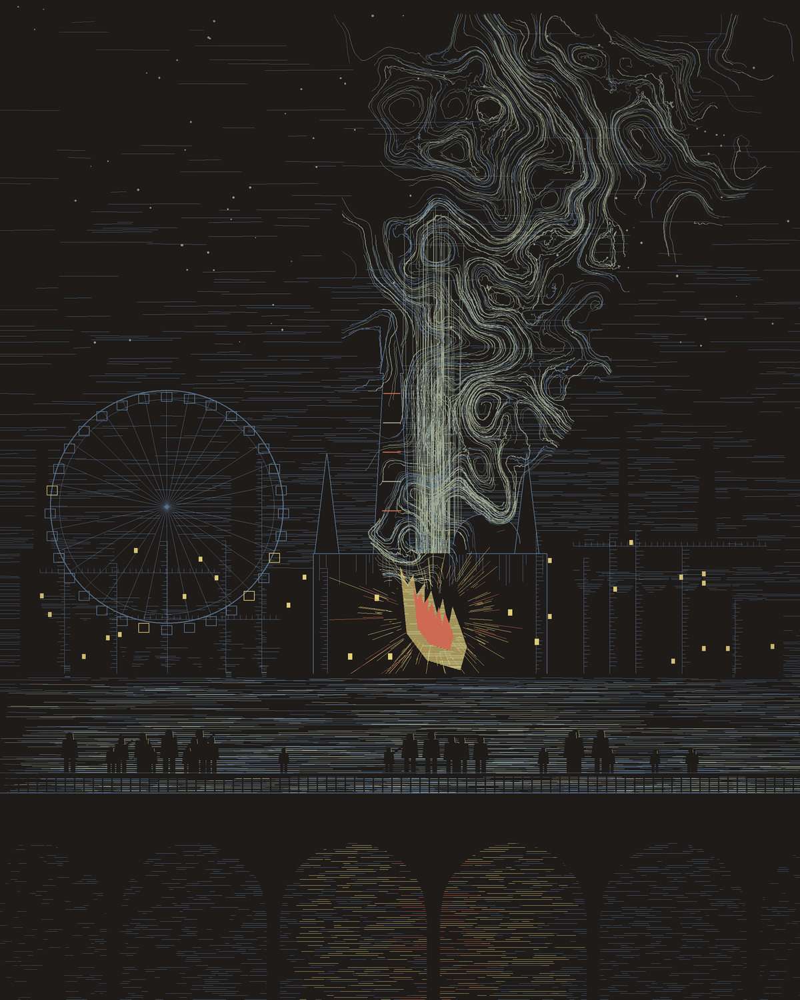
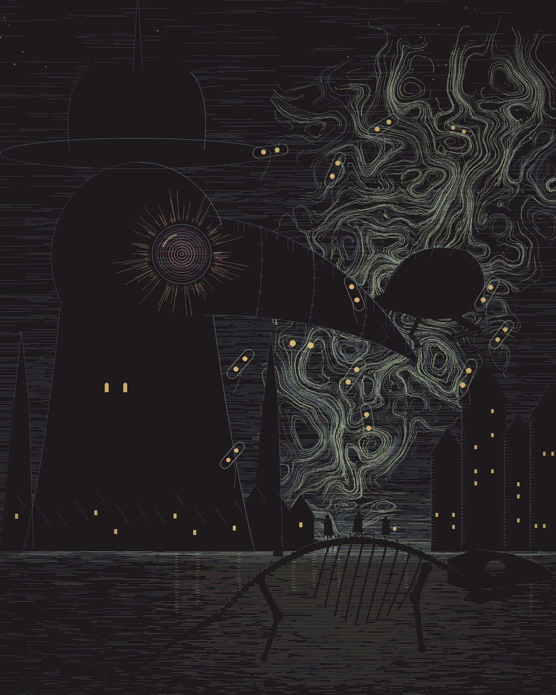
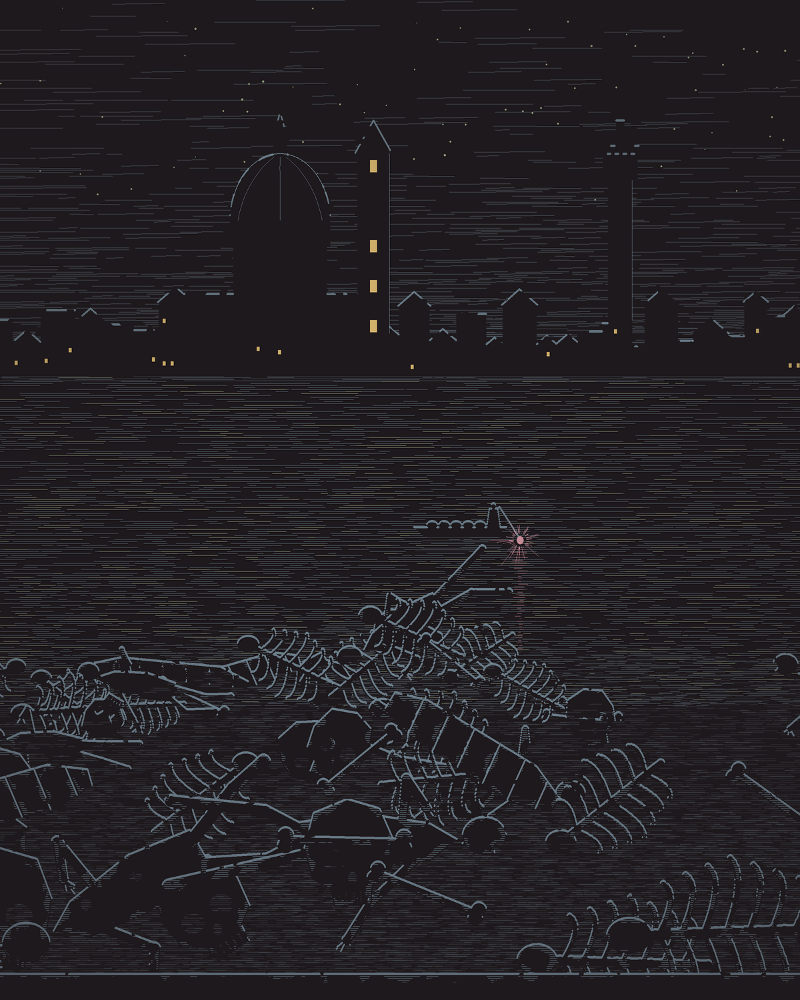
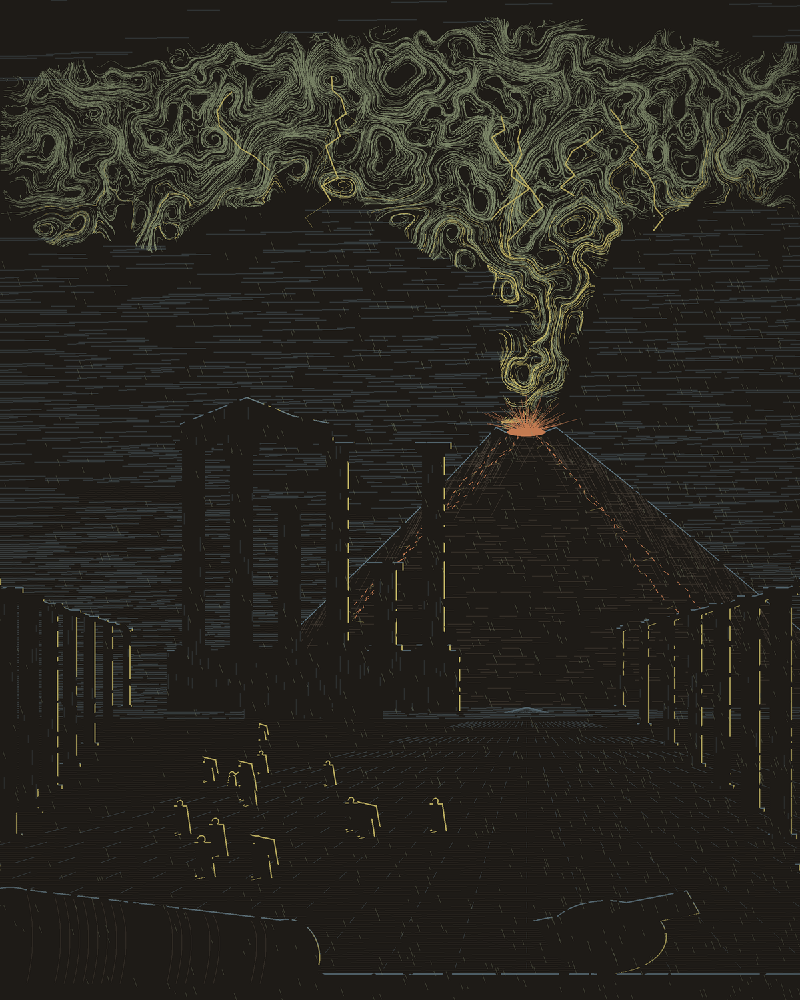
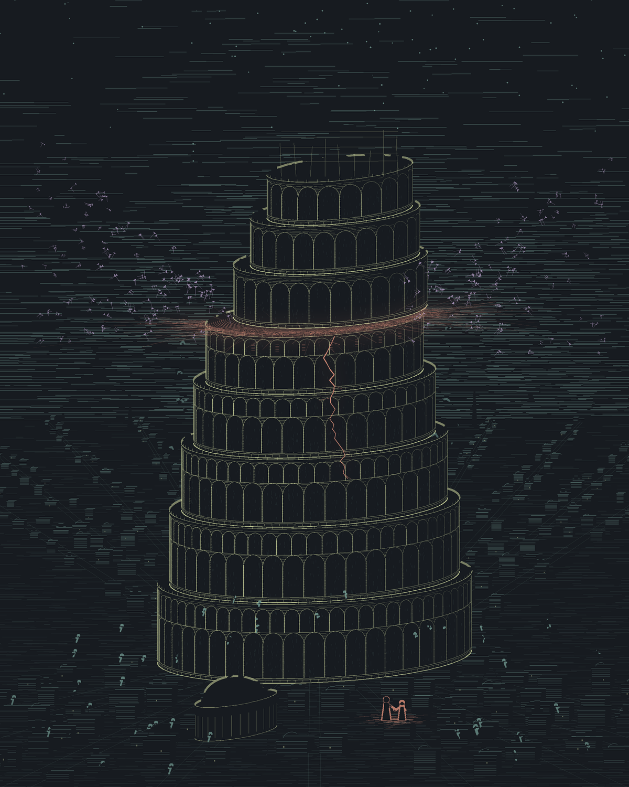

# 怪诞蚀刻 · Grotesque Etching

**一根针在涂黑的铜版上刻出来的暗黑童话。**

纯代码画（Python + numpy + Pillow），不用任何 AI 生图模型。深色打底，所有明暗都是一条条亮的细刻线：夜空、翻卷的青白烟、宏大怪诞的建筑、渺小的黑色人影，只有一扇扇窗和一个焦点是暖的。题材取自著名的灾难与历史事件。











## 作品

| No. | 题材 | 配色 | 运行 |
|---|---|---|---|
| 01 | 《切尔诺贝利》1986 年的那一夜，人们站在桥上看反应堆发光 | 17 标本编号 | `python works/01-chernobyl/chernobyl_night.py 4` |
| 02 | 《黑死病》1348 年佛罗伦萨，鸟嘴面具长成钟塔，巨蚤爬上喙尖，鼠骨架成桥 | 13 寄生生物 | `python works/02-plague/plague_tower.py 1` |
| 02-II | 《黑死病 · 尸岸》城在顶上，河在中间，下面是病死的人和枯骨堆成的岸 | 13 寄生生物 | `python works/02-plague/plague_pile.py 1` |
| 03 | 《庞贝》公元 79 年，从朱庇特神庙的废墟望向维苏威，伞松一样的灰云盖住天，人在广场上逃 | 15 生态退化 | `python works/03-pompeii/pompeii.py 1` |
| 06 | 《巴别塔》一层层拱廊圆柱叠成的塔从第五层错开，楔形文字从裂缝飘散，人群往四面逃，只有两个人在裂缝的光里牵着手 | 07 异质生命 | `python works/06-babel/babel.py 1` |

## 自己跑一张

```bash
git clone https://github.com/Qisi3344/grotesque-etching-Skill.git
cd grotesque-etching-Skill
pip install numpy pillow scipy
python works/01-chernobyl/chernobyl_night.py 4    # 参数是随机种子
```

图存在当前目录，1200×1500。换个种子，烟、城、人群都会长成另一种样子。

## 配色

全部取自 `palettes.md` 里 18 组生物标本 / 科学档案感配色：每组最深的颜色压深当夜空，其余刻线。

## 当作 AI Skill 用

`SKILL.md` 是给 AI 读的说明书：配色规则、刻线技法、构图、怎么挑题材。放进支持 Skill 的 AI 工具，然后说「用怪诞蚀刻画黑死病」就行。

## 目录

```
SKILL.md                      Skill 主体
palettes.md                   18 组配色 + 压深底色
works/<编号-题材>/            每张作品的代码与说明
examples/                     示例图
reference/midjourney-sref.md  最初的风格灵感（Midjourney sref 实测）
```

## 致谢

- 风格灵感：小红书「尤安Yoann」《怪诞风格探索分享》（Midjourney `--sref 6819387`）
- 配色：小红书「暴风无敌审美大王」《配色分享｜生物标本、科学档案感》，雾染整理

---

概念与审美：**绮思** · 代码：**澜** · Skill 骨架：Muse

代码以 [MIT 协议](LICENSE) 开源。用它画了图的话，欢迎来分享 🖤
